# 지원서 자동입력 · 설치와 사용 안내

공기업·사기업·해외 기업 지원서를 쓸 때마다 반복해서 입력하는 **이름, 연락처, 주소, 병역, 우대사항, 학력, 자격증, 경력**을 버튼 한 번으로 채워 주는 크롬 확장 프로그램입니다.

- 내 정보는 **이 컴퓨터의 크롬 안에만 암호화되어 저장**되고, 인터넷으로 보내지 않습니다.
- 자기소개서와 **최종 제출은 직접** 합니다. 확장은 제출 버튼을 누르지 않습니다.
- 크롬(Chrome) 브라우저에서만 동작합니다.

---

## 1. 설치하기 (처음 한 번, 약 3분)

### 1-1. 압축 풀기

받은 zip 파일을 풀면 `지원서자동입력_v버전` 폴더가 나옵니다. 이 폴더를 **지우거나 옮기지 않을 곳**(예: 문서 폴더)에 두세요. 폴더를 지우면 확장도 동작하지 않습니다.

### 1-2. 크롬에 불러오기

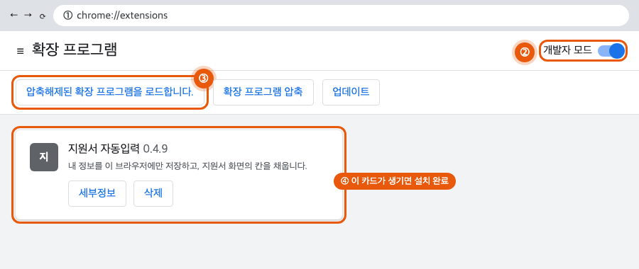

1. 크롬 주소창에 `chrome://extensions` 를 입력하고 Enter
2. 오른쪽 위 **개발자 모드** 스위치를 켭니다
3. 왼쪽 위 **압축해제된 확장 프로그램을 로드합니다** 를 누르고, 1-1에서 푼 폴더를 선택합니다
4. "지원서 자동입력" 카드가 생기면 설치 완료입니다

> 크롬 웹스토어를 거치지 않은 확장이라 개발자 모드가 필요합니다. 크롬이 가끔 "개발자 모드 확장 프로그램" 안내를 띄우면 **유지**를 선택하세요.

### 1-3. 아이콘 고정하기

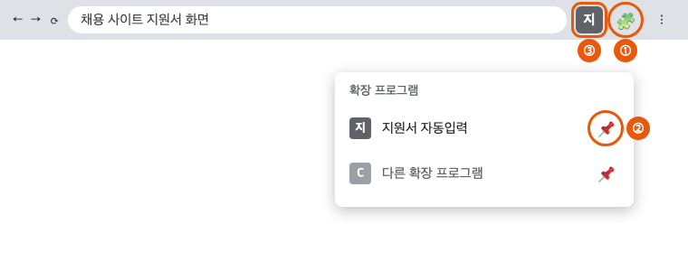

1. 주소창 오른쪽 **퍼즐 조각(🧩)** 아이콘 클릭
2. "지원서 자동입력" 옆 **핀(📌)** 클릭
3. 주소창 옆에 **"공"** 아이콘이 항상 보입니다

---

## 2. 내 정보 저장하기 (처음 한 번, 15~20분)

"공" 아이콘 → **내 정보 설정** 을 누르면 설정 화면이 새 탭으로 열립니다.

### 2-1. 잠금 암호 정하기

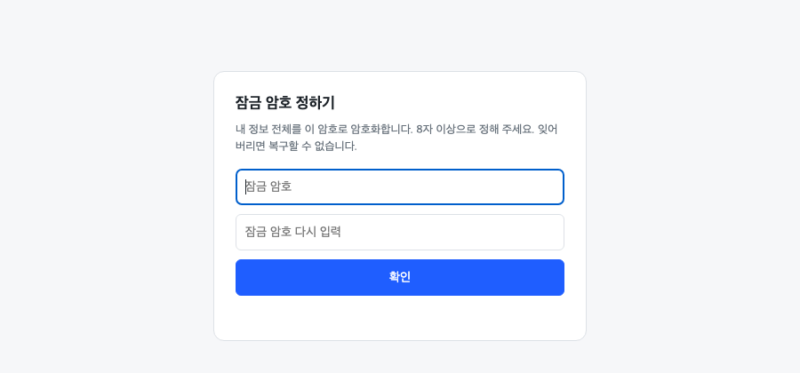

- 내 정보 전체를 이 암호로 암호화합니다. **8자 이상**으로 정하세요.
- 잠금 암호는 어디에도 저장되지 않아 **잊어버리면 복구할 수 없습니다.** 따로 적어 두세요.
- 크롬을 켠 뒤 처음 사용할 때 한 번 입력합니다. 크롬을 닫으면 다시 잠깁니다.

### 2-2. 내 정보 입력

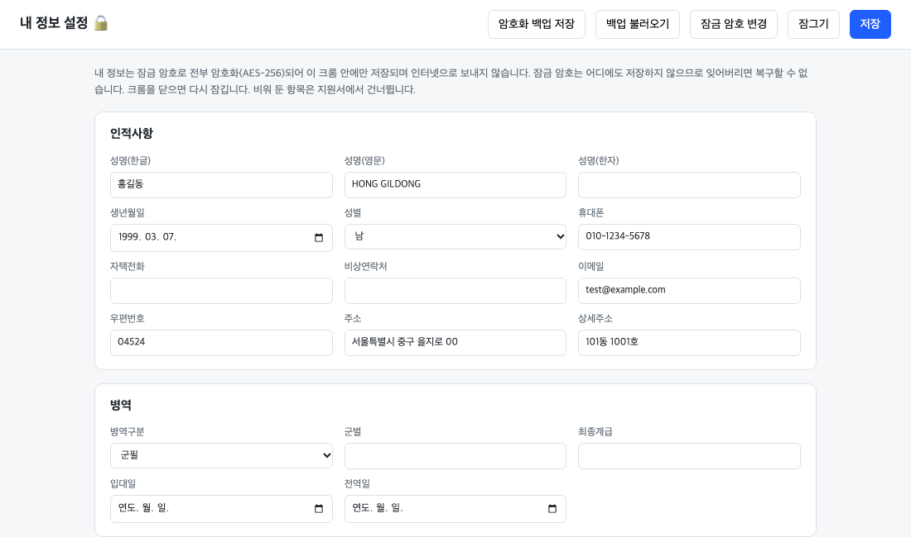

- 아는 항목만 채우면 됩니다. **비워 둔 항목은 지원서에서 건너뜁니다.**
- 날짜는 달력에서 고르면, 사이트마다 원하는 형식(20240101, 2024.01.01 등)으로 바꿔 넣습니다.
- 학력·자격증·어학·경력은 **+ 추가** 로 줄을 늘립니다. 지원서 위쪽 줄부터 순서대로 들어가니, 학력은 고등학교 → 대학교 순으로 넣으세요.
- 우대사항(보훈, 장애, 기초생활수급자, 지역인재 등)은 **비대상/대상** 을 골라 두면 사이트 질문에 맞춰 자동으로 고릅니다.
- 다 입력하면 오른쪽 위 **저장** 을 누릅니다.

- **기타·추가 항목도 채워 두면 더 많이 채워집니다.** 회사 지원서에 자주 나오는 항목을 모아 두었습니다.
  - 기타: 취미, 특기, 색약여부, 지원경로, 희망연봉, 신입/경력, 입사 가능일, 추천인(이름·관계·소속)
  - 병역: 복무형태(현역병 등), 복무 개월 버튼(18/21/24 개월 버튼이 있는 사이트용)
  - 인적사항: 거주 도시(영문, 예: Seoul) — 외국계 회사 지원서의 Location (City) 칸용
  - 학력: 총 이수학점, 본교/분교, 연구분야, 지도교수
  - 어학: 외국어, 회화·작문·독해 수준, 시험 주최기관
  - 경력: 연봉, 퇴직사유, 경력 연차
  - 프로젝트·수상·대외활동·해외경험·컴퓨터 활용능력: **+ 추가** 로 줄을 늘려 입력

**새 항목(0.5.76~0.5.79):** "온라인 프로필 · 현재 직장"(LinkedIn·GitHub·포트폴리오·웹사이트 주소, 현재 회사 — 해외 지원서용), 주소·학교명·전공·회사명·직위·담당업무·자격증명·상훈명의 "(영문)" 칸(영문 이력서용, 비워도 됨), **증명사진**(사진 고르기 → 가운데를 3:4로 잘라 내 정보와 함께 암호화 저장).

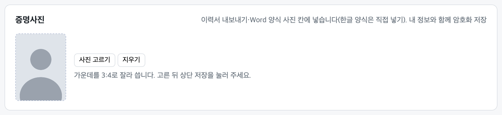

### 2-3. 자격증은 이미지로 한 번에

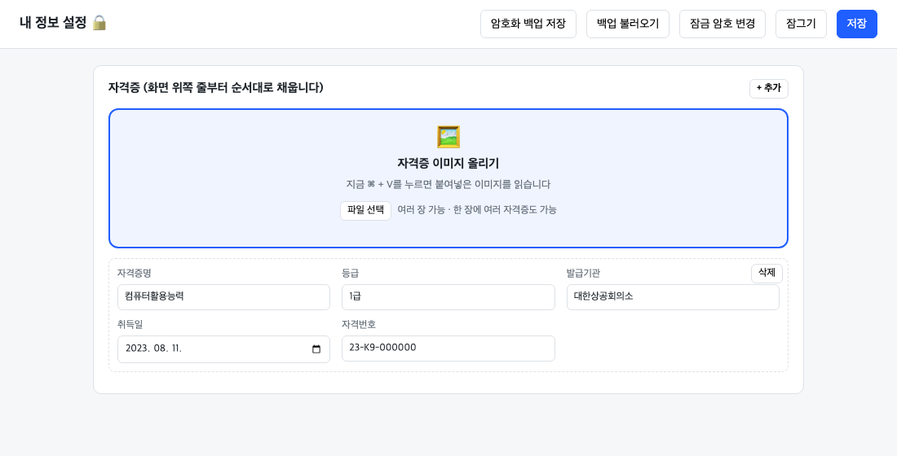

자격증 칸 위의 **자격증 이미지 올리기** 상자를 쓰면 자격증을 일일이 입력하지 않아도 됩니다.

- **끌어다 놓기:** 자격증 사진·캡처를 상자 위로 끌어다 놓기
- **붙여넣기:** 상자를 클릭한 뒤 **⌘ + V**(윈도우는 Ctrl + V)
- **파일 선택:** 여러 장을 한 번에 고를 수 있습니다

한 장에 자격증이 여러 개 있어도 위 → 아래 순서로 나눠 넣습니다. **Q-Net 마이페이지 자격 목록**이나 **대한상공회의소 자격 목록**을 캡처해서 붙여넣으면 편합니다.

> 사진에서 읽은 줄은 **노란색**으로 표시됩니다. 글자 인식이 가끔 틀리니(특히 자격번호의 영문 한 글자), **저장 전에 노란 줄을 꼭 확인**하세요. 못 읽은 글자는 `?` 로 표시됩니다.

---

## 3. 지원서에서 사용하기

### 3-1. 채우기

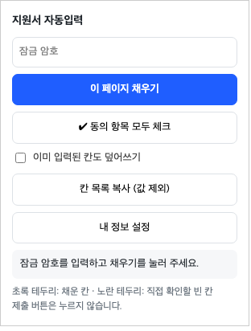

1. 채용 사이트에서 **본인인증·로그인까지 직접** 마치고 지원서 화면을 엽니다
2. 주소창 옆 **"공"** 아이콘 클릭
3. 크롬을 켠 뒤 처음이면 **잠금 암호** 입력
4. **이 페이지 채우기** 클릭

| 버튼 | 하는 일 |
|---|---|
| 이 페이지 채우기 | 지금 화면의 칸을 읽어 내 정보로 채움 |
| 칸 알려 주기 | 노란 칸을 클릭하고 내 정보 항목을 골라 사이트별 연결을 저장 |
| ✔ 동의 항목 모두 체크 | 개인정보 수집·이용 동의 같은 체크 칸을 한 번에 체크 (내용은 직접 읽어 보세요) |
| 이미 입력된 칸도 덮어쓰기 | 체크하면 값이 있는 칸도 새로 채움 (기본은 빈 칸만) |
| 칸 목록 복사 (값 제외) | 칸 이름과 구조만 복사 (문제 제보용, 내 정보는 안 들어감) |
| 내 정보 설정 | 설정 화면 열기 |

### 3-2. 결과 확인

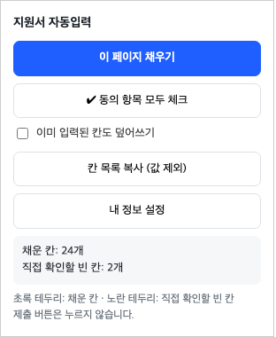

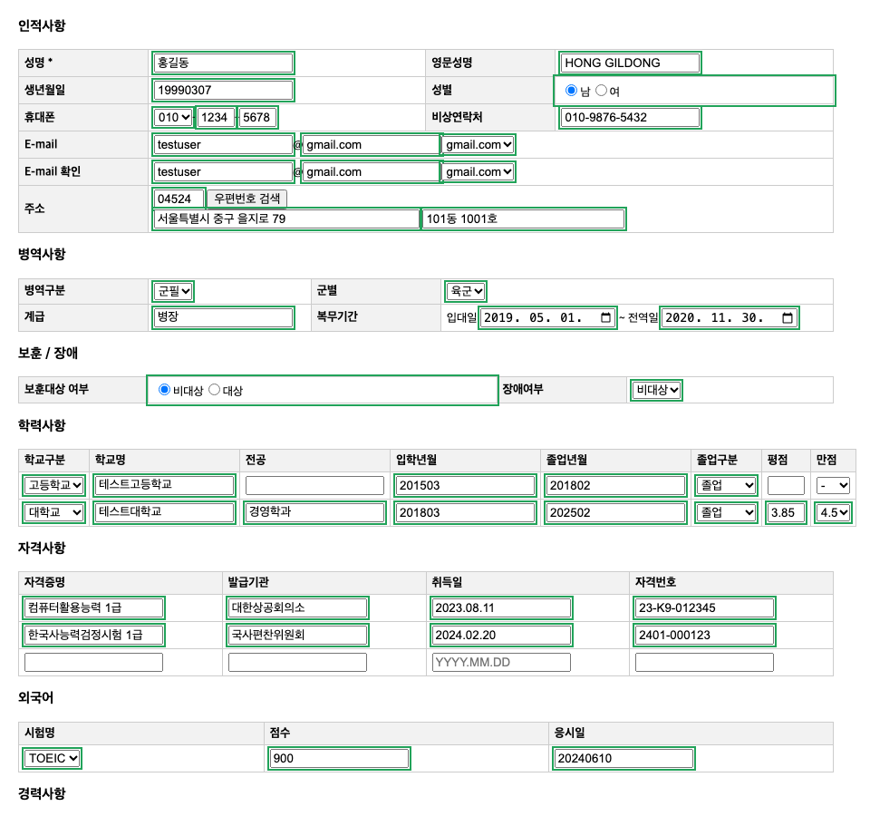

- **초록 테두리:** 자동으로 채운 칸
- **노란 테두리:** 인식하지 못했거나 내 정보에 없는 칸 → 직접 확인
- **손대지 않는 칸:** 주민등록번호, 인증번호, 비밀번호, 자기소개서
- **KLI Postcodify 주소:** **이 페이지 채우기**를 누르면 파란 **우편번호** 탭을 열고 저장된 주소를 검색합니다. 우편번호가 일치하는 결과가 하나일 때 자동 선택해 상세주소를 채우고 주소 창의 **저장**, 이어서 「저장하시겠습니까?」 창의 **확인**까지 누릅니다. 지원서 제출은 누르지 않습니다. 결과가 없거나 여러 개이면 주소는 클립보드에 복사되므로 직접 검색해 고르세요.
- **주소 검색 창이 필요한 사이트:** 주소를 클립보드에 복사해 둡니다. **우편번호 검색** 버튼을 눌러 검색 칸에 **⌘ + V**(윈도우는 Ctrl + V) 후 결과를 고르세요.
- **학교 검색이 필요한 사이트:** 학교명을 검색 칸에 넣고 검색까지 합니다. 결과에서 학교를 클릭하세요.
- **외국계 회사 지원서(Greenhouse 등)의 선택 목록:** 국가·도시·보훈·장애·병역처럼 눌러서 고르는 목록은 실제 키 입력으로 골라야 해서, 잠깐 크롬 위쪽에 **"디버깅 중"** 안내 띠가 떴다가 끝나면 사라집니다. 정상 동작입니다. 개인정보 동의 목록은 직접 고르세요.

확인이 끝나면 자기소개서를 쓰고 **제출은 직접** 누르세요.

### 3-3. 칸 알려 주기 (안 채워지거나 잘못 채워진 칸 바로잡기)

확장이 모르는 칸이 있으면 한 번만 알려 주세요. 다음부터 그 사이트에서는 자동으로 채웁니다.

1. 지원서 화면에서 "공" 아이콘 → **칸 알려 주기**를 누릅니다. (채우기를 먼저 누르지 않아도 됩니다)
2. 고를 수 있는 칸에 **파란 테두리**가 생깁니다. 알려 줄 칸을 누르세요. 빈 칸, 잘못 채워진 칸, 목록·버튼 묶음 모두 됩니다.
3. 뜬 창에 **지금 인식된 항목**이 보입니다. 넣을 **내 정보 항목**을 고르고 **저장**을 누릅니다.
   - 넣으면 안 되는 칸(예: 회색으로 잠긴 칸)은 **이 칸은 건너뛰기**
   - 잘못 알려 준 칸은 **알려 준 연결 지우기**
4. 다른 칸도 이어서 누를 수 있습니다. 다 했으면 **Esc** 또는 **끝내기**를 누릅니다.
5. 팝업에서 **이 페이지 채우기**를 다시 누르면 알려 준 대로 채워집니다.

- 저장되는 것은 "이 사이트의 이 칸 = 항목" 연결뿐이며, **내 정보 값은 저장하지 않습니다.**
- 주민등록번호·비밀번호·인증번호 칸은 알려 줘도 채우지 않습니다.
- 알려 준 연결은 **내 정보 설정** 화면 맨 아래 **칸 알려 주기로 저장한 연결**에서 보고 지울 수 있습니다.

### 3-4. 잘 안 될 때

| 상황 | 해결 |
|---|---|
| "이 페이지에서는 실행할 수 없습니다" | 지원서 탭을 새로고침(⌘ + R, 윈도우는 F5)한 뒤 다시 시도 |
| 채우기 뒤 "우편번호를 검색해주세요" 알림 | 우편번호 검색 버튼으로 주소를 직접 고르기 (주소는 복사되어 있음) |
| 학력·자격증 줄이 모자람 | 사이트의 **+ 추가하기** 를 먼저 눌러 줄을 늘린 뒤 채우기 |
| 특정 칸이 계속 안 채워짐 | **칸 목록 복사** → 배포한 사람에게 보내기 (칸 이름만 복사되고 내 정보는 없음) |
| 잠금 암호를 잊어버림 | 복구 불가. 설정 화면에서 정보를 다시 입력해야 합니다 |

### 3-5. 회사 양식 파일 채우기 (Word · PowerPoint · 한글)

회사가 이력서 양식 파일을 따로 주는 경우에 씁니다.

1. 설정 화면(팝업의 **설정 열기**) 맨 위 **회사 양식 파일 채우기** 칸에 양식 파일을 끌어다 놓거나 **파일 선택** 으로 고릅니다.
2. 표의 칸 이름(성명·생년월일·연락처·주소 등)을 보고 (만   )·(우편번호)·~ 같은 안내 글자만 있는 칸도 빈 칸으로 보고 오른쪽(또는 아래) 빈 칸에 내 정보를 넣고, '학교명·전공·기간'처럼 칸 이름이 한 줄에 늘어선 표는 아래 빈 줄에 학력·자격증·경력을 차례로 넣습니다.
3. 아래에 **채운 결과 미리보기**(양식의 표 배치, 새로 채운 칸은 초록색)가 나옵니다. 확인한 뒤 **내려받기** 를 누르면 원본은 그대로 두고 **파일이름_채움** 파일이 내려받기 폴더에 생깁니다. 맺음말의 "지원자 :" 옆에는 이름을 넣고, 사진·자기소개서·가족사항·서명은 파일에서 직접 채웁니다.

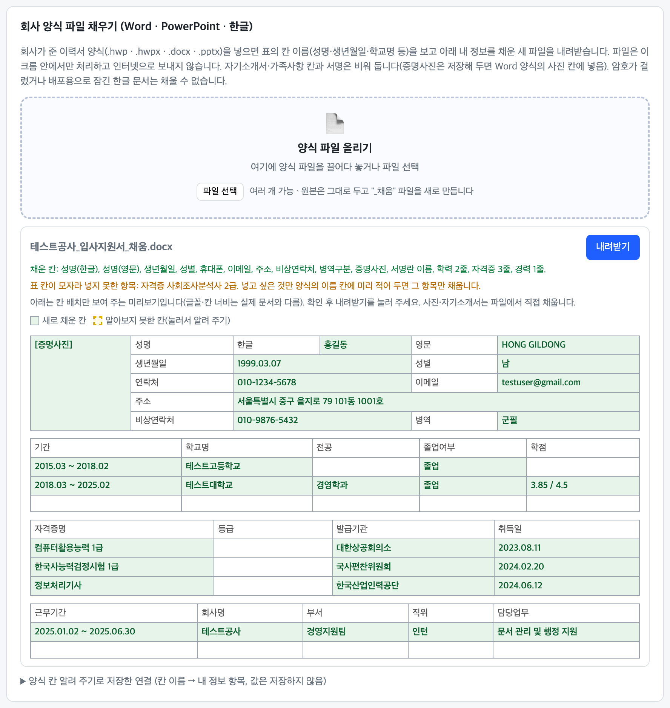

**자격증을 골라 넣기:** 자격증이 표 칸보다 많으면 저장된 순서대로 들어가고 남은 것은 "표 칸이 모자라 넣지 못한 항목"으로 알려 줍니다. 넣고 싶은 자격증만 양식의 자격증 이름 칸에 미리 적어 두면(예: "컴활 1급", "정보처리기사") 그 자격증의 취득일·발행기관만 채우고, 남은 빈 줄에는 나머지를 차례로 넣습니다. 어학 시험 표도 같습니다.

| 파일 | 가능 여부 |
|---|---|
| 한글 .hwp · .hwpx · Word .docx · PowerPoint .pptx | 바로 채움 |
| 암호가 걸린 한글 문서 · 배포용 한글 문서 | 채울 수 없음(한글에서 암호를 푼 뒤 넣기) |
| 옛 Word .doc · PowerPoint .ppt | Word·PowerPoint에서 .docx · .pptx 로 저장한 뒤 넣기 |

**웹 지원서 사진 첨부(0.5.83):** 증명사진을 저장해 두면 "이 페이지 채우기" 때 사진·photo 첨부 칸에 자동으로 올립니다(자격증 사본·증명서·포트폴리오·이력서 같은 서류 칸은 건드리지 않음). 팝업에 "증명사진 n곳 첨부"가 나오면 사이트의 사진 미리보기를 확인하고, 자르기 창이 뜨면 직접 맞춥니다.

**자동으로 함께 채우는 것:** 맺음말·동의서의 "20  년  월  일"(오늘 날짜), "지원자/동의인 :      (서명)"(이름, 서명은 비움), 표가 아닌 줄글 양식의 "성명 : ______" 같은 줄, Word 양식의 "사진" 칸(증명사진을 저장해 둔 경우. 한글 양식의 사진은 직접 넣기).

**칸 알려 주기:** 미리보기에서 노란 점선 칸은 알아보지 못한 칸입니다. 눌러서 넣을 내 정보 항목을 고르면 바로 다시 채우고, 다음부터 다른 양식에서도 같은 칸 이름이면 자동으로 채웁니다(칸 이름과 항목만 저장, 값은 저장하지 않음). 저장한 연결은 같은 구역 아래 목록에서 지울 수 있습니다.

### 3-6. 내 이력서 내보내기 (Word · PDF)

회사 양식이 없을 때 저장된 내 정보로 일반 이력서를 만듭니다.

1. 설정 화면의 **내 이력서 내보내기** 에서 **Word(.docx)로 내보내기** 또는 **PDF로 저장** 을 누릅니다.
2. **이력서에 넣을 항목 고르기** 가 열립니다. 구역(병역·학력·자격사항 등)과 줄(자격증 하나하나)마다 체크를 켜고 끕니다. **모두 선택 / 모두 해제** 도 있습니다. 고른 결과는 크롬을 닫기 전까지 기억합니다.

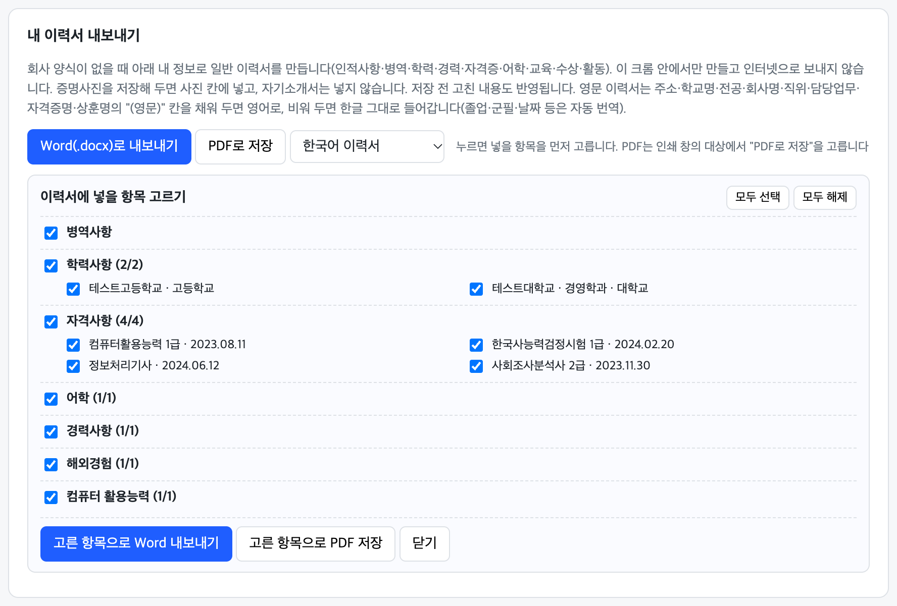
3. 옆의 언어 선택에서 **영문 이력서 (English)** 를 고르면 영어 이력서가 됩니다(학교명·회사명 등은 "(영문)" 칸을 채워 둔 것만 영어, 졸업·군필·날짜는 자동 번역).
4. **고른 항목으로 Word 내보내기** 는 `이력서_이름.docx` 파일을 내려받고, **고른 항목으로 PDF 저장** 은 인쇄 창을 엽니다(대상에서 **PDF로 저장** 선택).
5. 증명사진을 저장해 두면 한국어 이력서에 들어갑니다. 자기소개서·서명은 파일에서 직접 넣습니다. 이력서는 이 크롬 안에서만 만들고 외부로 보내지 않습니다.

---

## 4. 업데이트하기

새 버전 zip을 받으면:

1. 새 zip을 풀어 **기존 폴더와 바꿔 넣기**(같은 위치, 같은 폴더 이름)
2. `chrome://extensions` → "지원서 자동입력" 카드의 **새로고침(⟳)** 클릭

0.5.65부터 "디버거" 권한이 추가되었습니다. 새로고침 뒤 크롬이 권한을 다시 묻거나 확장을 꺼 두면 **사용** 으로 켜 주세요.

내 정보는 크롬 안에 그대로 남아 있습니다. 혹시 모르니 업데이트 전에 설정 화면의 **암호화 백업 저장** 으로 백업해 두세요.

---

## 5. 개인정보 안내

- 내 정보는 **이 컴퓨터의 크롬 안에만** AES-256으로 암호화되어 저장됩니다. 일반 자동입력은 프로필 정보를 외부로 보내지 않습니다.
- Postcodify 우편번호 자동검색을 사용하는 경우, 주소 검색어는 Postcodify 주소 서비스로 전달됩니다. 저장된 우편번호는 검색 결과를 고르는 데 이 컴퓨터 안에서만 사용하며, 이름·연락처 등 다른 프로필 항목은 검색어로 보내지 않습니다. Postcodify가 검색 요청 처리에 사이트 도메인 등 기술 정보를 받을 수 있습니다.
- 칸 알려 주기 기능은 사이트 주소·칸 식별값·내 정보 항목 경로만 별도로 저장하며, 입력값은 저장하지 않습니다.
- 자격증 이미지 글자 인식도 **이 컴퓨터 안에서만** 처리합니다.
- 회사 양식 파일 채우기도 **이 컴퓨터의 크롬 안에서만** 파일을 열고 고칩니다. 양식 파일과 내 정보를 외부로 보내지 않습니다.
- 디버거 권한은 채우기 버튼을 누른 탭에서 선택 목록을 고를 때만 잠깐 붙였다가 바로 뗍니다. 외부로 보내는 것은 없습니다.
- 백업 파일도 암호화되어 있어 잠금 암호 없이는 읽을 수 없습니다.
- 다른 사람과 같이 쓰는 컴퓨터에서는 쓰고 나서 설정 화면의 **잠그기** 를 누르거나 크롬을 닫으세요.

---

<small>글자 인식: tesseract.js (Apache-2.0) · 국가자격 종목명: 한국산업인력공단 국가자격 종목 목록(공공데이터포털)</small>
